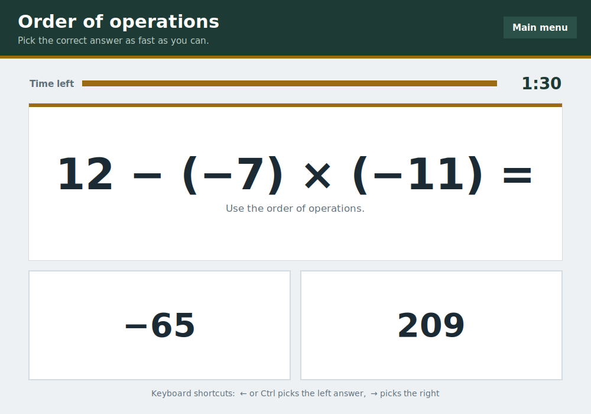
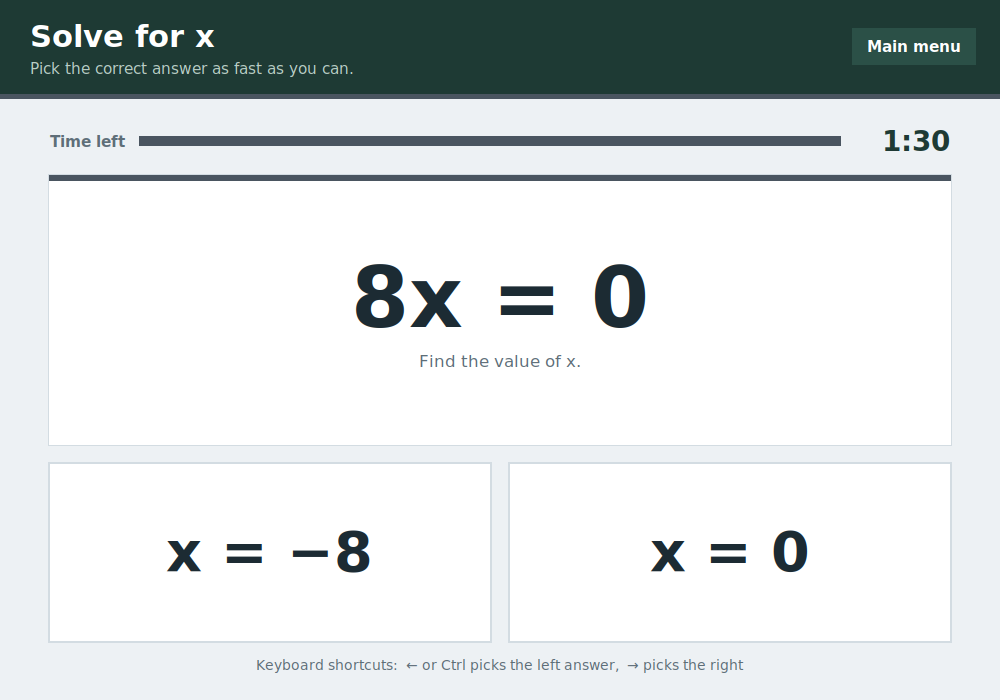
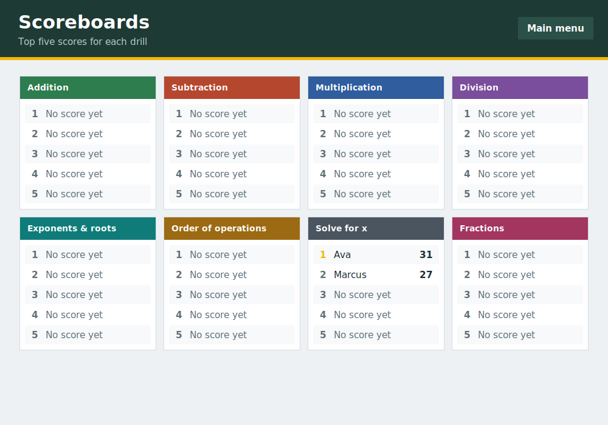
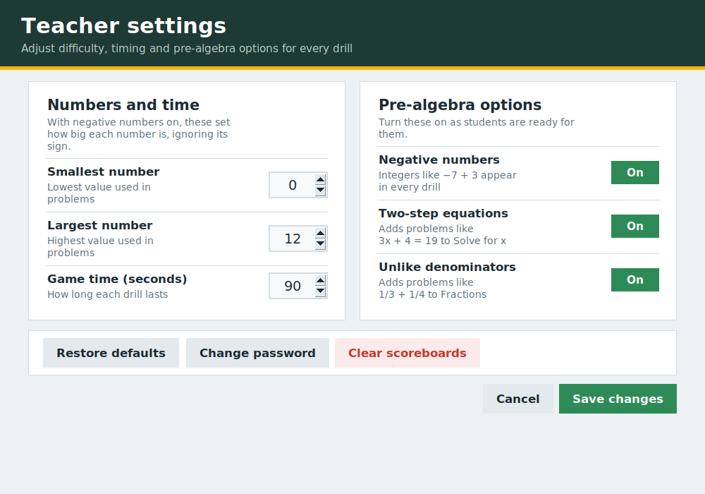

# Arithmetic Drills

A timed math practice game for the classroom, covering everything from basic facts through pre-algebra. Students see a problem and two possible answers, and pick the right one as fast as they can before time runs out. Teachers control difficulty, timing and which pre-algebra skills are included from a password-protected settings screen.

Built with Python and Tkinter. No other installs are needed.


## Features

- **Eight drills:** addition, subtraction, multiplication, division, exponents and roots, order of operations, solve for x, and fractions.
- **Two-choice format:** each problem shows one correct answer and one wrong answer. The wrong answer is usually a mistake students really make, so the drill checks understanding as well as speed.
- **Keyboard or mouse:** students can click an answer or use the arrow keys.
- **Scoreboards:** the top five scores for each drill are saved between sessions.
- **Teacher settings:** set the number range and game length, and turn negative numbers, two-step equations and unlike denominators on or off.
- **Resizable window:** the layout adjusts to the window size, and long problems shrink to fit.

| Order of operations | Solve for x |
| --- | --- |
|  |  |

## The drills

| Drill | Example problems |
| --- | --- |
| Addition | `7 + 5`, `−9 + (−7)` |
| Subtraction | `12 − 4`, `10 − (−4)` |
| Multiplication | `6 × 8`, `−3 × (−6)` |
| Division | `54 ÷ 9`, `−16 ÷ 4` |
| Exponents & roots | `(−5)²`, `4³`, `√81` |
| Order of operations | `12 − 3 × 4`, `(6 + 2) × 5`, `9 − 4 + 2` |
| Solve for x | `x + 7 = 15`, `4x = 28`, `x ÷ 3 = 6`, `3x − 5 = 16` |
| Fractions | `1/4 + 2/4`, `2/3 − 1/6`, `3/4 × 2/5` |

Problems with negative numbers only appear when **Negative numbers** is turned on in settings. Fraction answers are always given in lowest terms.

### How wrong answers are chosen

Instead of a random number, the wrong answer is usually a common error:

- **Order of operations:** the answer you get by working left to right. For `3 + 4 × 2`, the choices are 11 and 14.
- **Fractions:** the answer you get by adding the tops and the bottoms. For `1/2 + 1/3`, the choices are 5/6 and 2/5.
- **Exponents:** multiplying instead of using the power. For `5²`, the choices are 25 and 10.
- **Solve for x:** using the wrong inverse operation, or forgetting a step.
- **Negative numbers:** the correct answer with the wrong sign.

## Getting started

### Requirements

- Python 3.8 or newer
- Tkinter, which comes with Python on Windows and macOS

On Linux, Tkinter may need to be installed separately:

```bash
# Debian / Ubuntu
sudo apt install python3-tk

# Fedora
sudo dnf install python3-tkinter
```

### Running the game

```bash
git clone https://github.com/<your-username>/<your-repo>.git
cd <your-repo>
python math_game.py
```

On some systems the command is `python3` instead of `python`.

## How to play

1. Choose a drill from the main menu.
2. Pick the correct answer before the timer runs out.
3. When time is up, type your name and select **Save score**, or press Enter.

| Key | Action |
| --- | --- |
| `←` or `Ctrl` | Choose the left answer |
| `→` | Choose the right answer |
| `Enter` | Save your score on the results screen |

The selected answer flashes green when it's right and red when it's wrong.

**Scoring:** your score is the number of correct answers minus the number of incorrect answers, so guessing doesn't pay off.



## Teacher settings

Select **Settings** in the top-right corner of the main menu and enter the password. The default password is `password`. Change it the first time you use the game in a classroom.



| Setting | What it does | Default |
| --- | --- | --- |
| Smallest number | Lowest value used in problems | 0 |
| Largest number | Highest value used in problems | 12 |
| Game time | Length of each drill, in seconds | 90 |
| Negative numbers | Adds integers to every drill | Off |
| Two-step equations | Adds problems like `3x + 4 = 19` to Solve for x | On |
| Unlike denominators | Adds problems like `1/3 + 1/4` to Fractions | On |

With negative numbers on, the smallest and largest number settings control how big each number is, and its sign is chosen at random. A few drills keep their numbers smaller so they stay mental math: multiplication inside order of operations and solve for x uses factors up to 12, squares go up to 15², and cubes up to 6³.

From the settings screen you can also restore the defaults, change the password, or clear every scoreboard.

## Saved files

The game creates these files in the folder you run it from:

| File | Contents |
| --- | --- |
| `settings.json` | Teacher settings and the password |
| `High_Scores_Add.json` | Addition scores |
| `High_Scores_Sub.json` | Subtraction scores |
| `High_Scores_Mul.json` | Multiplication scores |
| `High_Scores_Div.json` | Division scores |
| `High_Scores_Exp.json` | Exponents & roots scores |
| `High_Scores_Order.json` | Order of operations scores |
| `High_Scores_Solve.json` | Solve for x scores |
| `High_Scores_Frac.json` | Fractions scores |

To start fresh, delete these files or use **Clear scoreboards** in settings.

> **Note:** the password is stored as plain text in `settings.json`. It keeps students out of the settings screen, but it isn't real security, so don't reuse a password that matters.

## Project structure

```
.
├── math_game.py      # The whole game
├── README.md
└── screenshots/      # Images used in this README
```

The code in `math_game.py` is organized into four screens, each a Tkinter frame:

- **`MainMenu`:** the drill tiles, scoreboard button and password prompt.
- **`GameScreen`:** problem generation, the timer, answer checking and the results card.
- **`ScoreboardScreen`:** the top five scores for each drill.
- **`SettingsScreen`:** teacher options, password changes and scoreboard reset.

To add a new drill, add an entry to `SCORE_FILES`, `CATEGORY_INFO` and `CATEGORY_ORDER`, and write a `gen_...` method in `GameScreen`. The method returns the problem text, the correct answer, and a list of likely wrong answers. Then register the method in `GameScreen.GENERATORS`.

## License

No license has been chosen yet. Do whatever you want.